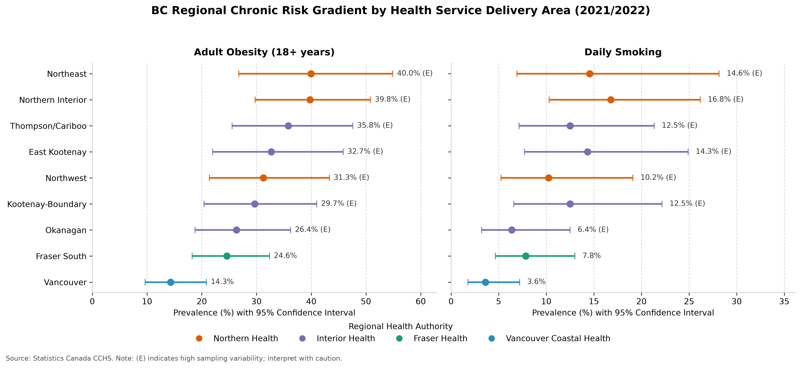
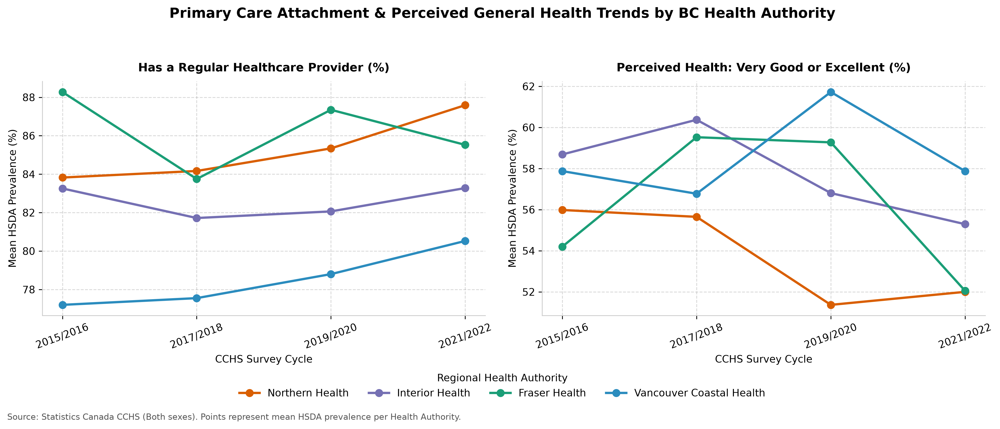
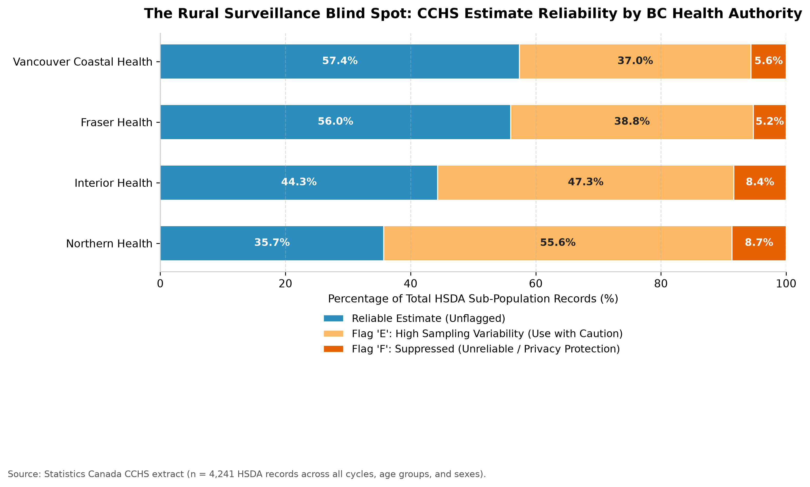

# # BC Health Authority Surveillance Project (2015–2022)

A personal data analysis project exploring regional health trends and survey data quality across British Columbia. I built this using public **Statistics Canada Canadian Community Health Survey (CCHS)** data to practice data cleaning in Python, querying in SQLite, and visualizing public health indicators.

---

## What I Explored & Key Takeaways

Using **4,241 cleaned records** across four CCHS survey cycles (`2015/2016` to `2021/2022`) and nine BC Health Service Delivery Areas (HSDAs), I focused on three main questions:

1. **Regional Chronic Disease Risk Factors:** In the `2021/2022` cycle, adult obesity rates in Northern BC (**40.0%** in Northeast; **39.8%** in Northern Interior) were much higher than in Vancouver (**14.3%**). Daily smoking showed a similar pattern (**16.8%** in Northern Interior vs. **3.6%** in Vancouver).
2. **Access to a Regular Doctor vs. Perceived Health:** Vancouver Coastal Health actually had the lowest percentage of residents with a regular healthcare provider (**80.5%** in `2021/2022` vs. **87.6%** in Northern Health), likely because urban areas have younger populations who use walk-in clinics. However, Northern Health still reported lower overall *very good or excellent* perceived health (**52.0%**), showing that having a doctor on paper doesn't capture every rural health challenge.
3. **Rural Data Reliability (`E` and `F` Flags):** Because rural and northern regions have smaller survey sample sizes, **64.3%** of subgroup records in Northern Health had Statistics Canada high-variability warnings (`E`: **55.6%**) or suppressed numbers (`F`: **8.7%**), compared to **42.6%** in Vancouver Coastal Health.

---

## Charts

### 1. Adult Obesity & Daily Smoking by Area (with 95% Confidence Intervals)


### 2. Regular Healthcare Provider & Perceived General Health Over Time


### 3. Survey Data Reliability by Health Authority


---

## How the Project is Organized

```text
bc-health-authority-surveillance/
├── data/
│   ├── raw/                  # Original Statistics Canada CSV download
│   └── processed/            # Cleaned CSV table and local SQLite database
├── sql/
│   └── 01_surveillance_queries.sql  # SQL queries for quality checks, trends, and regional averages
├── src/
│   ├── 01_clean_transform.py # Reshapes raw StatCan data and maps HSDAs to Health Authorities
│   ├── 02_run_sql_analysis.py# Runs the SQL queries and saves summary tables
│   └── 03_generate_visuals.py# Creates the three charts shown above
└── outputs/
    ├── tables/               # CSV outputs from the SQL queries
    └── figures/              # Saved PNG chartsbc-health-authority-surveillance
Epidemiological trend and regional disparity analysis across British Columbia Health Authorities using Python and SQL.
